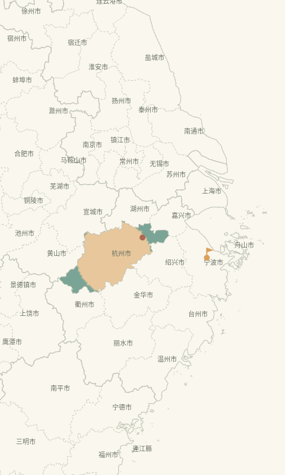

# 旅页 · 智能旅行手账

一个由用户自己设计足迹的 Android 旅行手账。首页用原生画布绘制随包城市边界：未去城市保留浅色轮廓，已去城市可填自选颜色或照片拼贴，想去地点插一面小旗。支持离线缩放、移动、长按选点和笔记预览，保留杂志风排版、独立搜索与联网旅行灵感。

GitHub 下载：[1.3.0 原生城市拼贴地图测试版](https://github.com/z23747424-cpu/travel-journal/releases/tag/v1.3.0)。附件 `lvye-1.3.0.apk` 为安装包，`lvye-source-1.3.0.zip` 为源码包，`SHA256SUMS.txt` 提供校验值。使用相同 debug 测试签名，旧版本保留。



上图来自实际 Android View/Canvas 的 Robolectric 离屏绘制，使用真实随包边界及合成图片夹具，不是手机或模拟器整机截图。实际照片观感、整机界面和 Android 16 触屏体验仍需设备验收。

## 使用

1. 安装 `release/旅页-1.3.0.apk`。包名不变，versionCode 递增为 4；同一测试签名可用于覆盖更新测试。更新前建议导出备份。
2. 首页显示本地城市轮廓，无需地图 SDK、地图 Key、网络瓦片或 WebView。长按位置，或通过“查找城市”选择地点，再写手账。双指/按钮缩放、拖动浏览、全国复位均可用。
   “去过”只填充对应城市，可选择柔和预设色、自定义 `#RRGGBB` 或照片拼贴；“想去”插旗，不填城。点击已有地点先预览照片和摘要，再打开手账。同城多篇保留，插画仍可在编辑页指定、调大小并长按拖动。全国视野聚合密集标记，放大后展开。教学示例不算实际去过。
3. 在“设置”给账本精灵取名。普通记录和浏览不要求配置 AI。
4. 需要 AI 时填写 HTTPS 服务地址、API 密钥与模型名称，阅读并勾选发送说明，保存后测试连接。服务须兼容 Chat Completions；照片整理另需模型支持图片输入。
5. 编辑手账时勾选 1～4 张照片，请精灵生成候选标签和照片笔记，确认后才写入草稿。
6. “搜索”用于寻找已有手账。“灵感”根据需求实际联网搜索网页，再由 AI 整理推荐；需要在设置中另外填写 Tavily 搜索 API 密钥。推荐有来源链接，可加入想去清单，再创建关联手账。
7. 更换手机或卸载前，在设置中导出 ZIP 备份。备份包含手账、照片与想去清单，不含 AI 密钥。
8. 从地图页的“全部手账”浏览原有记录。旧记录没有坐标时不会被猜测位置，在编辑页点击“在地图选点”即可补充；标注也可更改或移除。离线时仍可通过全部手账记录和阅读。

## AI 接入

- 地址可填 `https://服务商域名/v1` 或完整的 `https://服务商域名/v1/chat/completions`，其他服务前缀按其文档填写。软件不会替你购买调用额度。
- 同一模型用于文字任务与照片任务；文本连接成功不等于已验证图片能力。若图片不支持，仍可手动录入标签。
- 不填内置账号和共享密钥。密钥保存在当前 Android 设备的加密存储里。
- 仅用户主动触发调用。识图发送所选照片的压缩副本；智能搜索发送查询和检索范围内的手账文字；推荐发送本次条件和目的地资料。
- 旅行推荐使用 Tavily Search 实际检索网页，没有内置目的地名单，也不限定中国。搜索密钥与模型密钥分别加密保存，备份均排除；没有配置或搜索失败时会提示，不拿模型记忆或历史资料冒充联网搜索。
- 中国轮廓及 391 个城市/独立行政单元素材随应用提供，地图不请求在线服务。此边界覆盖范围只用于绘制与城市包含判断，不限制 AI 的联网目的地推荐。位置落在边界以外仍可保存坐标笔记和旗帜，会明确提示暂无城市图块。
- 新版移除首页的在线街道图层。地图素材来源、学习用途和开放授权见 [地图说明](docs/地图与联网服务.md)；地图不申请 GPS 权限，不向地图服务发送照片或正文。
- 网页检索不保证所有信息实时准确；交通、预算、天气与开放情况仍应核对来源。

## 工程

共同开发请先阅读 [同学协作与 AI 交接指南](docs/COLLABORATION.md)，其中包含接受邀请、环境准备、分支与 PR、签名发版以及可直接复制给 AI 的提示词。

- 包名：`cn.edu.traveljournal`；最低 Android 8.0/API 26，目标 API 35。
- Kotlin、Jetpack Compose Material3、SQLite、本机照片目录、Android Keystore。
- 源码在 `app/src/main/java/cn/edu/traveljournal/`，原生地图素材在 `app/src/main/assets/atlas/`；位置保存在本机 JSON 记录里。旧网页资源保留作历史比较，不作为当前地图运行入口。
- 构建方法见 [构建环境](docs/构建环境.md)，本轮验证见 [1.3 验证记录](docs/验证记录-1.3.md)，双方代码边界见 [地图与 AI 分工](docs/地图与AI分工.md)。

标准构建命令：

```bash
./gradlew :app:assembleDebug :app:testDebugUnitTest :app:lintDebug
```

WSL 路线优先使用 `bash scripts/build.sh`；环境中仅有 Windows Android 工具时，使用 `scripts/build-windows.ps1`，自动处理中文路径导致的 Java 测试类加载问题，详见构建环境文档。Gradle wrapper 固定版本并校验下载的 SHA-256。

## 课程实验

软件使用已有多模态和语言模型做推理，没有自行训练基础模型。照片理解、语义检索和基于需求的目的地排序是机器学习应用部分。

`experiments/` 保留 1.0 的 36 篇虚构手账、36 条查询、20 组推荐需求与冻结基线。原 30 个目的地资料已迁入实验目录，不再打包进应用。该历史固定目录实验不代表 1.1 联网推荐的效果；新版要使用实际检索结果和独立标注另行测量。不能把模拟响应或样例基线称为真实模型准确率。

```bash
cd experiments
python3 evaluate.py
python3 run_model.py --help
```

具体指标、数据限制和模型运行方法见 `experiments/README.md`。这些样例由开发助手预先编写，尚未独立人工复核，不构成真实用户研究。

课堂演示顺序及机器学习部分的说明见 [课程展示](docs/课程展示.md)。

## 数据说明

手账、坐标、插画和照片只保存在当前手机；没有账号、云同步或多人共享后台。删除记录需要确认，草稿会暂存；导入备份不会覆盖已有同 ID 的记录。旧备份可继续导入，1.3 还保留城市代码、颜色与拼贴方式。城市照片引用原手账图片，恢复备份时沿用文件名重映射。想去旗帜不计入已去城市。

三篇可选示例的封面是程序原创示意插画，正文已明确标注，不能当成真实目的地实拍。应用代码、说明与教学素材随项目提供；第三方组件保留原有许可证，目的地资料来源保留链接。
