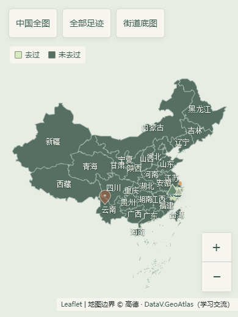

# 旅页 · 智能旅行手账

一个由用户自己设计足迹的 Android 旅行手账。首页直接显示随应用保存的完整中国省级底图，离线也能显示、平移和缩放；点选地点写笔记、插入自己的插画或照片，拖动调整位置。街道细节可以主动切换联网底图。保留杂志风排版、独立搜索与联网旅行灵感。

GitHub 下载：[1.2.0 完整地图与插画版](https://github.com/z23747424-cpu/travel-journal/releases/tag/v1.2.0)。附件 `lvye-1.2.0.apk` 为安装包，`lvye-source-1.2.0.zip` 为源码包，`SHA256SUMS.txt` 提供校验值。使用 debug 测试签名，1.0/1.1 安装包和标签保留。



上图是地图网页组件的离线实测，插画为程序绘制示例；手机整体界面仍待真机验收。

## 使用

1. 安装 `release/旅页-1.2.0.apk`。使用同一测试签名、递增版本号，可用于原版覆盖更新测试；更新前建议导出备份。
2. 首页显示完整中国地图，无需地图 Key 或网络。可缩放、移动并选点：写笔记，或点“用自己的插画标记这里”导入相册图片，确认保存后显示在地图上。点插画查看笔记，拖动插画保存新位置；编辑页可指定图片、调节大小或取消插画显示。
   地点可选择“去过／未去过”：去过的足迹会点亮对应省级区域，未去过保持暗色。默认小标记，全国视野收起插画文字标签，放大后再显示设定大小。教学示例默认不算实际去过。
3. 在“设置”给账本精灵取名。普通记录和浏览不要求配置 AI。
4. 需要 AI 时填写 HTTPS 服务地址、API 密钥与模型名称，阅读并勾选发送说明，保存后测试连接。服务须兼容 Chat Completions；照片整理另需模型支持图片输入。
5. 编辑手账时勾选 1～4 张照片，请精灵生成候选标签和照片笔记，确认后才写入草稿。
6. “搜索”用于寻找已有手账。“灵感”根据需求实际联网搜索网页，再由 AI 整理推荐；需要在设置中另外填写 Tavily 搜索 API 密钥。推荐有来源链接，可加入想去清单，再创建关联手账。
7. 更换手机或卸载前，在设置中导出 ZIP 备份。备份包含手账、照片与想去清单，不含 AI 密钥。
8. 从地图页的“全部手账”浏览原有记录。旧记录没有坐标时不会被猜测位置，在编辑页点击“在地图选点”即可补充；标注也可更改或移除。离线时仍可通过全部手账记录和阅读。

## AI 接入

- 地址可填 `https://服务商域名/v1` 或完整的 `https://服务商域名/v1/chat/completions`，其他服务前缀按其文档填写。软件不会替你购买调用额度。
- 同一模型用于文字任务与照片任务；文本连接成功不等于已验证图片能力。若图片不支持，仍可手动录入标签。
- 不填内置账号和共享密钥。密钥保存在当前 Android 设备的加密存储里。
- 仅用户主动触发调用。识图发送所选照片的压缩副本；智能搜索发送查询和检索范围内的手账文字；推荐发送本次条件和目的地资料。
- 旅行推荐使用 Tavily Search 实际检索网页，没有内置目的地名单，也不限定中国。搜索密钥与模型密钥分别加密保存，备份均排除；没有配置或搜索失败时会提示，不拿模型记忆或历史资料冒充联网搜索。
- 中国全图和省级地理边界随应用提供，默认不加载网络瓦片。用户自行设计游玩地点，没有固定旅游地点名单。底图来源和学习用途见 [地图服务说明](docs/地图与联网服务.md)。
- “街道底图”是可选联网图层，需要网络；连接失败时仍显示本地完整中国地图。世界其他区域的街道细节也依赖联网。无需地图 Key，不申请 GPS 权限，不发送手账正文或插画给地图服务，没有批量离线街道下载。
- 网页检索不保证所有信息实时准确；交通、预算、天气与开放情况仍应核对来源。

## 工程

共同开发请先阅读 [同学协作与 AI 交接指南](docs/COLLABORATION.md)，其中包含接受邀请、环境准备、分支与 PR、签名发版以及可直接复制给 AI 的提示词。

- 包名：`cn.edu.traveljournal`；最低 Android 8.0/API 26，目标 API 35。
- Kotlin、Jetpack Compose Material3、SQLite、本机照片目录、Android Keystore。
- 源码在 `app/src/main/java/cn/edu/traveljournal/`，地图网页资源在 `app/src/main/assets/map/`；位置以 WGS84 经纬度保存在本机 JSON 记录里。
- 构建方法与环境见 [构建环境](docs/构建环境.md)，本轮验证范围见 [1.2 验证记录](docs/验证记录-1.2.md)。

标准构建命令：

```bash
./gradlew :app:assembleDebug :app:testDebugUnitTest :app:lintDebug
```

WSL 路线优先使用 `bash scripts/build.sh`；环境中仅有 Windows Android 工具时，使用 `scripts/build-windows.ps1`，自动处理中文路径导致的 Java 测试类加载问题，详见构建环境文档。Gradle wrapper 固定版本并校验下载的 SHA-256。

## 课程实验

软件使用已有多模态和语言模型做推理，没有自行训练基础模型。照片理解、语义检索和基于需求的目的地排序是机器学习应用部分。

`experiments/` 保留 1.0 的 36 篇虚构手账、36 条查询、20 组推荐需求与冻结基线。原 30 个目的地资料已迁入实验目录，不再打包进应用。该历史固定目录实验不代表 1.1 联网推荐的效果；新版要使用实际检索结果和独立标注另行测量。不能把模拟响应或样例基线称为真实模型准确率。

```bash
cd experiments
python3 evaluate.py
python3 run_model.py --help
```

具体指标、数据限制和模型运行方法见 `experiments/README.md`。这些样例由开发助手预先编写，尚未独立人工复核，不构成真实用户研究。

课堂演示顺序及机器学习部分的说明见 [课程展示](docs/课程展示.md)。

## 数据说明

手账、坐标、插画和照片只保存在当前手机；没有账号、云同步或多人共享后台。删除记录需要确认，草稿会暂存；导入备份不会覆盖已有同 ID 的记录。1.0/1.1 备份可继续导入，1.2 备份保留插画、大小和位置。想去清单不计入已旅行记录。

三篇可选示例的封面是程序原创示意插画，正文已明确标注，不能当成真实目的地实拍。应用代码、说明与教学素材随项目提供；第三方组件保留原有许可证，目的地资料来源保留链接。
