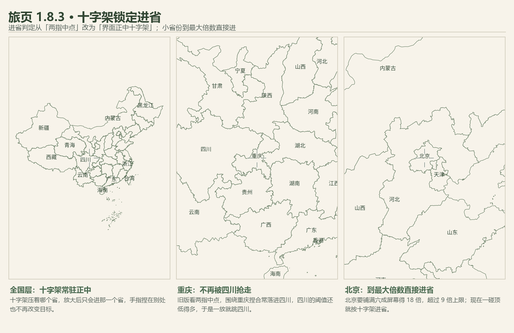

# 旅页 · 智能旅行手账

一个可以记录回忆，也能计划下一程的 Android 手账。首页由原生画布显示随包中国省市边界：全国层看省份，放大后进入省内看区县；选中板块突出、周围淡化，未去城市保留浅色轮廓，已去城市可填自选颜色或照片拼贴，想去地点插一面小旗。暖纸、自托管手写标题和手绘边角沿用已确认的电脑原型，操作使用原生 Compose / Material3，不需要地图 SDK、Key、网络瓦片或 WebView。

GitHub 下载：[1.8.4 进省判定修复版](https://github.com/z23747424-cpu/travel-journal/releases/tag/v1.8.4)。附件 `lvye-1.8.4.apk` 为安装包，`lvye-source-1.8.4.zip` 为源码包，`SHA256SUMS.txt` 提供校验值。使用相同 debug 测试签名，旧版本保留。



上图来自实际 Android View/Canvas 的 Robolectric 离屏绘制，使用真实随包边界及合成图片夹具，不是手机或模拟器整机截图。实际照片观感、整机界面和真机触屏体验仍需设备验收。

## 使用

1. 安装 `release/旅页-1.8.4.apk`（包名 `cn.edu.traveljournal.dev`，versionCode 15）。与旧版同一测试签名，可直接覆盖升级；升级前建议先在旧版导出 ZIP 备份。
2. 首页是全国省界。**屏幕正中有一个固定十字架**：双指缩放以十字架为锚，十字架压在哪个省就进哪个省；小省（北京、上海、天津、港澳）放到最大倍数也会直接进，可在设置里关掉。
3. 进省后看到该省的区县，再放大可看区县细节；继续缩小会一路退回全国，且十字架仍停在刚才那个省上。
4. 点省份打开相册，长按省份或点「记一笔」开始记录。城市和标题选填，正文或照片至少一项；省份必选。旧坐标与城市记录保留，以随包边界归入省份，不能确定归属的内容仍在全部手账。
5. 在相册选择「封面与省份装饰」独立保存照片拼贴或颜色。想去标记支持小旗、定位、星、心或本地图片，颜色和大小可改。新笔记不会重置省份设计；手账封面单独保存，不再限制 12 张照片。
6. 「灵感」有找下一站、我的计划和想去清单。AI 先搜索推荐目的地，再为选定地点生成可编辑的逐日草案；支持天数和安排增删排序、交通、预算、日期及备忘。无密钥也可手写计划。
7. 计划关联国内省份是可选的明确选择；海外地点不受地图范围限制。计划只插旗，不自动变成去过。草稿可继续、保存或确认放弃；保存后的计划可再改或删除。
8. 在设置中接入自己的 AI。普通记录、地图、搜索和备份都不需要 AI 配置。
9. 设置中导出/导入 ZIP。v2 包含已保存手账、照片、封面、收藏、旅行计划和省份设计，不包含密钥或未保存草稿。v1 备份仍可导入；同 ID 记录和计划作为新项导入，已有省份设计优先保留。
10. 电脑预览与 Android 各自保存数据；电脑 JSON 备份不是 Android ZIP。电脑预览入口与源码仍保留，Android 不依赖电脑服务或 WebView。

## AI 接入

- 两种接入方式：直接填 HTTPS 服务地址（兼容 Chat Completions），或用「AI 网页版」把网页回复粘回来由应用解析。
- 地址可填 `https://服务商域名/v1` 或完整的 `https://服务商域名/v1/chat/completions`，其他服务前缀按其文档填写。软件不会替你购买调用额度。
- AI 网页版可选 Kimi、豆包、千问、DeepSeek、ChatGPT；在应用内打开对应网页，复制回复后回来自动识别。
- 同一模型用于文字任务与照片任务；文本连接成功不等于已验证图片能力。若图片不支持，仍可手动录入标签。
- 不填内置账号和共享密钥。密钥保存在当前 Android 设备的加密存储里。
- 仅用户主动触发调用。识图发送所选照片的压缩副本；智能搜索发送查询和检索范围内的手账文字；推荐发送本次条件和目的地资料。
- 1.7.0 起移除内置 Tavily 联网检索，推荐改为「AI 网页版」由用户在网页侧完成检索，应用只做解析与整理，不把模型记忆冒充联网结果。
- 中国轮廓、391 个城市与 34 个省级区县素材随应用提供，地图不请求在线服务。此边界覆盖范围只用于绘制与城市包含判断，不限制 AI 的目的地推荐。位置落在边界以外仍可保存坐标笔记和旗帜，会明确提示暂无城市图块。
- 地图素材来源、学习用途和开放授权见 [地图说明](docs/地图与联网服务.md)；地图不申请 GPS 权限，不向地图服务发送照片或正文。
- 网页检索不保证所有信息实时准确；交通、预算、天气与开放情况仍应核对来源。

## 工程

共同开发请先阅读 [同学协作与 AI 交接指南](docs/COLLABORATION.md)，其中包含接受邀请、环境准备、分支与 PR、签名发版以及可直接复制给 AI 的提示词。

- 包名：`cn.edu.traveljournal`（协作者构建使用 `.dev` 后缀）；最低 Android 8.0/API 26，目标 API 35。
- Kotlin、Jetpack Compose Material3、SQLite、本机照片目录、Android Keystore。
- 源码在 `app/src/main/java/cn/edu/traveljournal/`；地图素材在 `app/src/main/assets/atlas/`（省级 `china-*.json`、区县 `counties/` 与 `county-index.json`）。旧网页资源保留作历史比较，不作为当前地图运行入口。
- 构建方法见 [构建环境](docs/构建环境.md)，本轮验证见 [1.8.4 验证记录](docs/验证记录-1.8.4.md)，双方代码边界见 [地图与 AI 分工](docs/地图与AI分工.md)。
- 区县边界由 `scripts/prepare-county-atlas.py` 从公开边界数据生成：拓扑保持简化（相邻县共享的边只简化一次），再量化坐标，避免放大后相邻县边界交叉。

标准构建命令：

```bash
./gradlew :app:assembleDebug :app:testDebugUnitTest :app:lintDebug
```

WSL 路线优先使用 `bash scripts/build.sh`；环境中仅有 Windows Android 工具时，使用 `scripts/build-windows.ps1`，自动处理中文路径导致的 Java 测试类加载问题，详见构建环境文档。Gradle wrapper 固定版本并校验下载的 SHA-256。

1.8.4 基线：`assembleDebug + testDebugUnitTest + lintDebug` 全绿，26 个测试类 / 143 条用例 / 0 失败，lint 0 error / 2 warning（均为历史遗留的 Compose 与无障碍提示）。

## 自 1.4.0 以来的更新

上一版公开版本是 1.4.0（versionCode 5）。此后每一版都有独立验证记录，摘要如下。

| 版本 | 主要内容 |
|---|---|
| 1.5.0 | 原生相册改版：省份颜色与照片拼贴、相册封面、想去标记五种形状与自定大小；「灵感」改为找下一站 / 我的计划 / 想去清单；AI 生成可编辑的逐日计划草案；计划可选关联省份；备份升级为 v2；暖纸与手写字体打包 |
| 1.6.1 | 新增「AI 网页版推荐」：在应用内打开网页 AI，回复粘回来自动解析；修复装机后看不到新版本（版本号未递增 / 包名混用）的问题 |
| 1.7.0 | 移除内置 Tavily 检索；修复「用它开始写计划」不可点；计划编辑页自动填省份；字体与字号局部统一 |
| 1.7.1 | AI 网页列表调整为 Kimi / 豆包 / 千问 / DeepSeek / ChatGPT |
| 1.8.0 | 搜索页背景图；全国 → 省 → 区县两级下钻；「想去清单」与「我的计划」合并；手账封面；取消每篇 12 张照片上限 |
| 1.8.1 | 区县边界改为拓扑保持简化，消除相邻县边界交叉；区县态只画本省区县 |
| 1.8.2 | 修复切进省地图时闪几帧「缩小版全国地图」 |
| 1.8.3 | 进省判定改为屏幕正中的固定十字架；小省放大到最大倍数直接进省（可在设置关闭） |
| 1.8.4 | 修复「放大进省后视角被弹回全国、十字架落到四川、于是进了四川」 |

细节与证据：[1.5](docs/验证记录-1.5.md) · [1.6.1](docs/验证记录-1.6.1.md) · [1.7.0](docs/验证记录-1.7.0.md) · [1.7.1](docs/验证记录-1.7.1.md) · [1.8.0](docs/验证记录-1.8.0.md) · [1.8.1](docs/验证记录-1.8.1.md) · [1.8.2](docs/验证记录-1.8.2.md) · [1.8.3](docs/验证记录-1.8.3.md) · [1.8.4](docs/验证记录-1.8.4.md)。

### 1.8.4 修的是什么

进省那一刻的倍数换算到省图层是 0.62，而省图层「继续缩小就退出」的阈值是 0.68——进省后下一帧就被判成要退回全国；退回时相机复位到全国默认中心（约 104.06, 30.67，成都附近），十字架随之落到四川，同一根手指又把四川进了。修法：进省倍数下限提到 0.95、退省时把刚才那个省留在十字架下、一次捏合最多切换一次层级并锁定目标省；顺带修掉慢捏时「缩放卡在 1 倍不动」。

## 课程实验

软件使用已有多模态和语言模型做推理，没有自行训练基础模型。照片理解、语义检索和基于需求的目的地排序是机器学习应用部分。

`experiments/` 保留 1.0 的 36 篇虚构手账、36 条查询、20 组推荐需求与冻结基线。原 30 个目的地资料已迁入实验目录，不再打包进应用。该历史固定目录实验不代表当前联网推荐的效果；新版要使用实际检索结果和独立标注另行测量。不能把模拟响应或样例基线称为真实模型准确率。

```bash
cd experiments
python3 evaluate.py
python3 run_model.py --help
```

具体指标、数据限制和模型运行方法见 `experiments/README.md`。这些样例由开发助手预先编写，尚未独立人工复核，不构成真实用户研究。

课堂演示顺序及机器学习部分的说明见 [课程展示](docs/课程展示.md)。

## 数据说明

手账、坐标、插画和照片只保存在当前手机；没有账号、云同步或多人共享后台。删除记录需要确认，草稿会暂存；导入备份不会覆盖已有同 ID 的记录。旧备份可继续导入。城市照片引用原手账图片，恢复备份时沿用文件名重映射。想去旗帜不计入已去城市。

三篇可选示例的封面是程序原创示意插画，正文已明确标注，不能当成真实目的地实拍。应用代码、说明与教学素材随项目提供；第三方组件保留原有许可证，目的地资料来源保留链接。